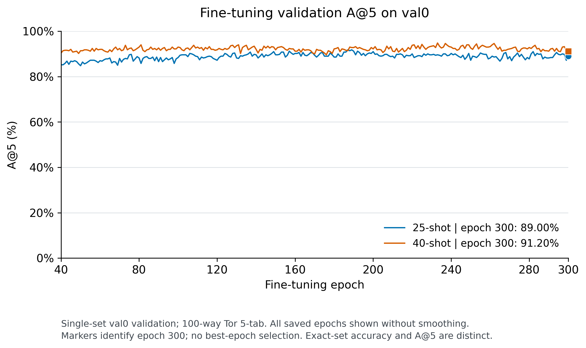
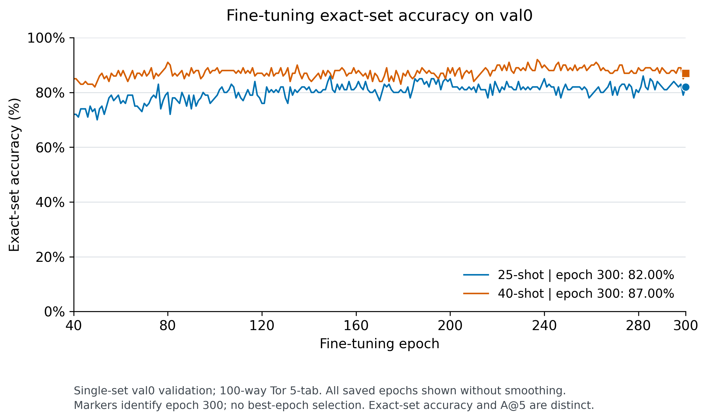

# FMWF — Multi-Tab Website Fingerprinting | Research Reproduction

**Reproduction of [Beyond Single Tabs: A Transformative Few-Shot Approach to Multi-Tab Website Fingerprinting Attacks](https://doi.org/10.1145/3696410.3714811), WWW 2025.**

This repository documents our reproduction of **FMWF**, a few-shot learning approach for identifying multiple visited websites from overlapping encrypted Tor traffic. We reproduced the original CNN architecture, completed synthetic pretraining and real-traffic fine-tuning, and evaluated the trained models against the paper's reported results.

**[Original Paper](https://doi.org/10.1145/3696410.3714811)** | **[Official Code](https://github.com/WW-Meng/FMWF)** | **[Full Reproduction Report](reports/FMWF_Reproduction_Report.pdf)** | **[Reproducibility Guide](docs/REPRODUCIBILITY.md)**

---

## 1. Reproduction Highlights

| Component | Result |
|---|---|
| Architecture | Original 4-block CNN + MLP, **8.83M parameters** |
| Synthetic pretraining | **10,000 traces, 200 epochs** |
| Real fine-tuning | **25-shot and 40-shot, 300 epochs each** |
| 25-shot mean A@5 | **88.72%** |
| 40-shot mean A@5 | **92.12%** |
| Published 25-shot A@5 | **≈91.0%** |
| Hardware | Apple Silicon, 16 GB, PyTorch MPS |
| Status | **Partial reproduction — selected experiments completed** |

**Main result:** Our 25-shot reproduction achieved **88.72% A@5**, approximately **2.28 percentage points below** the paper's reported 91%.

This is a numerical comparison, not a strictly protocol-matched benchmark: the original validation-set selection and checkpoint policy remain unidentified.

---

## 2. Original Research Paper

| Field | Details |
|---|---|
| **Title** | Beyond Single Tabs: A Transformative Few-Shot Approach to Multi-Tab Website Fingerprinting Attacks |
| **Authors** | Wenwen Meng, Chuan Ma, Ming Ding, Chunpeng Ge, Yuwen Qian, Tao Xiang |
| **Venue** | The Web Conference (WWW 2025), pp. 1068–1077 |
| **DOI** | [10.1145/3696410.3714811](https://doi.org/10.1145/3696410.3714811) |
| **Official repository** | [WW-Meng/FMWF](https://github.com/WW-Meng/FMWF) |
| **Audited commit** | `c970e0a38710f4bf260b5f63617cb59351af49cb` |

The original methodology and model belong to the authors. This repository documents our independent reproduction, evaluation, implementation adaptations, and analysis.

---

## 3. Research Problem and Methodology

### Multi-tab website fingerprinting

Website Fingerprinting (WF) identifies visited websites from observable encrypted-traffic characteristics, including packet direction and sequence patterns.

Traditional single-tab WF assumes one traffic trace corresponds to one website. With multiple Tor tabs open simultaneously, traffic from several websites overlaps, making the task **multilabel classification**.

The principal challenges include:

- Mixed traffic from multiple concurrently loaded websites.
- Limited availability of labeled real multi-tab traces.
- Differences between synthetic and realistic overlapping traffic.
- Variable browsing behavior and packet ordering.

### FMWF's core contribution

FMWF addresses real-data scarcity using a **two-stage learning strategy**:

1. **Synthetic pretraining:** Train a CNN using artificial multi-tab traces constructed from single-tab traffic.
2. **Few-shot fine-tuning:** Adapt the pretrained network using a small real multi-tab dataset.

### Reproduced pipeline

```text
        Single-tab Tor traces
                 |
                 v
       Synthetic multi-tab data
           10,000 samples
                 |
                 v
         CNN + MLP pretraining
              200 epochs
                 |
                 v
         Pretrained checkpoint
                 |
          +------+------+
          |             |
          v             v
      25-shot        40-shot
    2,500 traces   4,000 traces
          |             |
          v             v
        Fine-tuning (300 epochs)
          |             |
          v             v
       Final epoch-300 checkpoints
                 |
                 v
        Real 5-tab validation
                 |
                 v
       100 logits → Top-5 labels
                 |
                 v
        A@5 / Exact-set accuracy
```

We used the official pre-generated synthetic dataset rather than reconstructing the complete synthetic-generation procedure.

---

## 4. Model Architecture

The released model is a **four-block 1D CNN followed by fully connected layers**, operating directly on packet-direction sequences.

**Input:** `(batch_size, 1, 15000)`  
**Output:** `(batch_size, 100)`  
**Parameters:** **8,829,156**

| Layer | Architecture | Output |
|---|---|---|
| Conv Block 1 | 1→32→32, ELU | `(B,32,3749)` |
| Conv Block 2 | 32→64→64, ReLU | `(B,64,936)` |
| Conv Block 3 | 64→128→128, ReLU | `(B,128,233)` |
| Conv Block 4 | 128→256→256, ReLU | `(B,256,57)` |
| Flatten | 256 × 57 | `(B,14592)` |
| Dense 1 | 14592→512, BN, ReLU, Dropout 0.7 | `(B,512)` |
| Dense 2 | 512→512, BN, ReLU, Dropout 0.3 | `(B,512)` |
| Output | Linear 512→100 | `(B,100)` |

Convolutional blocks use batch normalization, activation, max pooling, and dropout. The model predicts website labels directly from combined traffic without explicitly separating individual tab streams.

**Training objective:** `MultiLabelSoftMarginLoss()` with all model parameters updated during fine-tuning.

The paper discusses weighted loss and softmax, whereas the released code uses unweighted loss and raw logits. Our reproduction follows the executable implementation.

---

## 5. Dataset and Preprocessing

### Datasets actually used

We used the official **Tor five-tab, closed-world, 100-way** datasets.

| Experiment | Dataset | Samples | CSV columns |
|---|---|---:|---:|
| Pretraining | `synthesis-5tabdataset.csv` | 10,000 | 15,100 |
| 25-shot fine-tuning | `tor-5tab-finetuning100way25shot.csv` | 2,500 | 15,106 |
| 40-shot fine-tuning | `tor-5tab-finetuning100way40shot.csv` | 4,000 | 15,106 |

**All samples were used; no training dataset reduction was performed.**

Each traffic sample contains 15,000 direction/padding values (`-1`, `0`, `+1`). Real five-tab labels are 100-dimensional multi-hot vectors with five positive entries.

Preprocessing follows the released CSV format:

```python
# Synthetic traces
labels = df.iloc[:, :100]
features = df.iloc[:, 100:]

# Real traces (six metadata columns skipped)
labels = df.iloc[:, :100]
features = df.iloc[:, 106:]
```

Features are converted to `float32` and reshaped to `(N, 1, 15000)`.

### Validation data

Final checkpoints were evaluated on the provisional selection `val0`–`val4`.

| File | Samples |
|---|---:|
| val0 | 100 |
| val1 | 100 |
| val2 | 100 |
| val3 | 200 |
| val4 | 100 |

**Important finding:** All 100 `val4` rows also occur within `val3`. Therefore, the five files contain **600 row occurrences but only 500 distinct inputs**.

The authors' original five validation filenames are unidentified. Our results are validation metrics, not measurements from a separately established untouched test set.

---

## 6. Implementation Environment and Configuration

### Environment

| Component | Configuration |
|---|---|
| OS | macOS, Apple Silicon ARM64 |
| Hardware | MacBook Air, 16 GB unified memory |
| Python | 3.12.16 |
| PyTorch | 2.3.0 |
| NumPy / pandas | 1.26.4 / 2.2.2 |
| scikit-learn / matplotlib | 1.5.1 / 3.9.2 |
| Backend | PyTorch MPS |

These are inspected local environment versions; a complete historical dependency lockfile was unavailable.

### Training configuration

| Parameter | Pretraining | Fine-tuning |
|---|---|---|
| Dataset | Synthetic | Real multi-tab |
| Epochs | 200 | 300 |
| Batch size | 32 | 32 |
| Learning rate | 0.001 | 0.001 |
| Optimizer | Adam | Adam |
| Loss | MultiLabelSoftMarginLoss | Same |
| Seed | 18 | 18 |
| Scheduler / early stopping | None | None |

The 25-shot and 40-shot runs independently initialized from the same pretrained checkpoint. All original released architecture and training hyperparameters were preserved.

**Checkpoint selection:** Final epoch-300 weights, not best-observed validation epochs.

---

## 7. Evaluation Metrics

### A@5 — Paper-defined metric

A@5 measures the fraction of the five predicted websites that belong to the true visited set:

$$
A@5(x)=\frac{1}{5}\sum_{i\in\operatorname{Top5}(z(x))} y_i
$$

For four correct predictions out of five, **A@5 = 80%**.

### Exact-set accuracy — Released-code metric

The released fine-tuning code uses scikit-learn's multilabel `accuracy_score`, requiring **all five predicted labels to match**.

For four correct predictions:

```text
A@5                = 80%
Exact-set accuracy = 0%
```

We retained the original exact-set metric and implemented paper-defined A@5 separately.

Final results use an **unweighted average across five validation-file scores**. Because these files overlap, their scores must not be interpreted as independent measurements.

---

## 8. Experimental Results

### 8.1 Paper versus reproduction

**Setting: Tor · Five tabs · Closed-world · 100-way · 25-shot**

| Metric | Published | Reproduced | Gap |
|---|---:|---:|---:|
| **A@5** | ≈91.00% | **88.72%** | **≈−2.28 pp** |

Approximate relative difference: **−2.51%**.


*Figure 1. Published 25-shot result versus reproduced final-checkpoint A@5. Exact protocol equivalence remains unverified.*

### 8.2 Final 25-shot and 40-shot results

| Configuration | Training samples | Mean A@5 | Mean exact-set |
|---|---:|---:|---:|
| **25-shot** | 2,500 | **88.72%** | **82.40%** |
| **40-shot** | 4,000 | **92.12%** | **87.10%** |

The 40-shot model achieved **+3.40 percentage points A@5** and **+4.70 percentage points exact-set accuracy** compared with 25-shot under our common evaluation procedure.

### 8.3 Per-file validation results

| File | n | 25-shot A@5 | 40-shot A@5 |
|---|---:|---:|---:|
| val0 | 100 | 89.00% | 91.20% |
| val1 | 100 | 87.20% | 91.20% |
| val2 | 100 | 84.40% | 90.40% |
| val3 | 200 | 90.40% | 93.80% |
| val4 | 100 | 92.60% | 94.00% |
| **Mean** | — | **88.72%** | **92.12%** |

Across-file population standard deviations: **2.79 pp** (25-shot) and **1.48 pp** (40-shot). These are descriptive values, not confidence intervals.


*Figure 2. Per-file A@5 from final epoch-300 checkpoints. `val4` is duplicated within `val3`.*

### 8.4 Fine-tuning behavior

| Configuration | Final val0 A@5 | Best observed val0 A@5 | Best epoch |
|---|---:|---:|---|
| 25-shot | 89.00% | 91.80% | 187, 189 |
| 40-shot | 91.20% | 94.80% | 233 |



*Figure 3. Unsmoothed validation A@5 across epochs 40–300. Best-observed values are not final-checkpoint results.*

Exact-set accuracy at epoch 300 was **82.00%** for 25-shot and **87.00%** for 40-shot on `val0`.



*Figure 4. Released-code exact-set accuracy throughout fine-tuning.*

### 8.5 Synthetic pretraining

The complete 200-epoch synthetic training run finished with:

| Metric | Final training value |
|---|---:|
| Loss | 0.0005 |
| Exact-set accuracy | 98.84% |
| Precision / Recall | 99.91% / 99.83% |
| F1-score | 99.85% |

**These are synthetic training metrics, not held-out real-traffic performance.**

No independently verified final real-traffic precision, recall, or F1 measurements were produced.

---

## 9. Key Findings and Implementation Challenges

### Findings

1. **Full selected training pipeline completed:** 200-epoch synthetic pretraining and independent 300-epoch 25/40-shot fine-tuning.
2. **25-shot performance approached the published headline:** 88.72% versus approximately 91.0%, with unresolved protocol differences.
3. **40-shot achieved higher validation A@5:** 92.12% versus 88.72%, using more real training samples.
4. **Evaluation metric mismatch identified:** Paper-defined A@5 differs from the original code's exact-set accuracy.
5. **Validation overlap detected:** `val4` is entirely contained within `val3`.
6. **Hardware feasibility demonstrated:** Full-size training completed on Apple Silicon MPS without reducing batch size or model architecture.

### Implementation modifications

| Challenge | Our approach | Type |
|---|---|---|
| CUDA-only assumptions | Added MPS/CPU compatibility | Compatibility |
| Hardcoded paths | Portable dataset/checkpoint handling | Compatibility |
| Checkpoint loading | Device-aware state loading | Compatibility |
| No 25-shot training entry point | Adapted official fine-tuning code | Experiment extension |
| No saved fine-tuned weights | Added final checkpoint saving | Infrastructure |
| Incorrect A@5 implementation | Added correct A@5 alongside exact-set | Evaluation correction |
| Single-file evaluation | Added provisional five-file evaluator | Experimental deviation |
| Unknown checkpoint policy | Consistently evaluated epoch 300 | Experimental choice |

Diagnostic one-epoch tests observed approximately **3.912 GiB RSS** during synthetic pretraining and **1.877 GiB RSS** during 40-shot testing. The 40-shot test processed 125 batches in **16.48 seconds**.

These are diagnostic observations, not complete training-runtime benchmarks.

---

## 10. Repository Structure

```text
FMWF-Reproduction/
├── README.md
├── LICENSING.md
├── CITATION.cff
├── requirements.txt
├── .gitignore
├── scripts/
│   ├── evaluate_5tab_validation_sets.py
│   ├── plot_final_reproduction_results.py
│   ├── reproduction_paths.py
│   ├── smoke_test_*.py
│   └── test_full_*_memory.py
├── results/
│   ├── figures/              # Four figures (PNG + PDF)
│   ├── metrics/              # Validation and evaluation CSVs
│   └── run_summary.json
├── reports/
│   └── FMWF_Reproduction_Report.pdf
└── docs/
    ├── PROVENANCE.md
    ├── PUBLICATION_AUDIT.md
    ├── PUBLICATION_MANIFEST.json
    ├── REPRODUCIBILITY.md
    └── reproduction_report/   # Editable report and build tools
```

**Excluded:** Original author source, derivative training scripts, raw datasets, model checkpoints, virtual environments, and training logs.

---

## 11. Reproduction Instructions

### Clone and prepare environment

```bash
git clone https://github.com/tanikaaaa/FMWF-Reproduction.git
cd FMWF-Reproduction

python3 -m venv .venv
source .venv/bin/activate
python -m pip install -r requirements.txt
```

### Obtain upstream implementation

```bash
git clone https://github.com/WW-Meng/FMWF.git FMWF-upstream
cd FMWF-upstream
git checkout c970e0a38710f4bf260b5f63617cb59351af49cb
```

Download the official dataset separately following the upstream instructions.

### Training commands used locally

The following were executed in our original, locally adapted FMWF working project:

```bash
# Synthetic pretraining
python -u FMWF-src/PretrainingModel.py

# 40-shot fine-tuning
python -u FMWF-src/tor-5tab-Accuracy.py

# 25-shot fine-tuning (locally derived script)
python -u FMWF-src/tor-5tab-25shot-Accuracy.py
```

These are historical local commands, **not directly executable from this public repository**. The original training code, local compatibility modifications, datasets, and checkpoints must be obtained or prepared separately.

For evaluation, see `scripts/evaluate_5tab_validation_sets.py` and [REPRODUCIBILITY.md](docs/REPRODUCIBILITY.md).

Existing measurements and plots are available under [`results/`](results/) without rerunning training.

---

## 12. Reproduction Status and Limitations

**Status: Partial reproduction — architecture and selected training experiments completed; exact evaluation-protocol equivalence unresolved.**

### Completed

- Original CNN architecture and parameter verification.
- Full synthetic pretraining and 25/40-shot fine-tuning.
- Final checkpoint evaluation using A@5 and exact-set accuracy.
- Dataset integrity checks, reproducibility audit, and technical report.

### Main limitations

| Limitation | Impact |
|---|---|
| Original five validation files unidentified | Direct benchmark equivalence unverified |
| `val4` fully overlaps `val3` | Validation files are not independent |
| Checkpoint-selection policy undocumented | Paper-versus-final-epoch comparison uncertain |
| Paper/code metric mismatch | Required independent A@5 implementation |
| Single documented run per configuration | No multi-seed significance estimates |
| Incomplete data provenance | Capture-session independence unverified |
| Only Tor five-tab closed-world reproduced | Other paper settings not evaluated |
| No untouched test-set measurement | Results represent validation performance |

The approximate **2.28-percentage-point gap** cannot presently be attributed to model quality, hardware differences, or any single cause.

### Potential research directions

- Standardized non-overlapping evaluation splits and metrics.
- Few-shot sample-efficiency studies with multiple seeds.
- Synthetic-to-real transfer analysis.
- Generalization across tab counts.
- Controlled comparison against TMWF, ARES, and Forge.

These are possible directions, not established novel contributions.

---

## 13. References and Attribution

**Original paper:** Wenwen Meng, Chuan Ma, Ming Ding, Chunpeng Ge, Yuwen Qian, and Tao Xiang. *Beyond Single Tabs: A Transformative Few-Shot Approach to Multi-Tab Website Fingerprinting Attacks.* WWW 2025, pp. 1068–1077.

- **Paper:** https://doi.org/10.1145/3696410.3714811
- **Official implementation:** https://github.com/WW-Meng/FMWF
- **Reproduction:** https://github.com/tanikaaaa/FMWF-Reproduction

The original authors retain credit for the FMWF model and methodology. This repository documents our reproduction experiments, evaluation utilities, dataset audits, and technical analysis.

Original source code and datasets are not redistributed because upstream redistribution permission could not be verified. See [LICENSING.md](LICENSING.md).

---

## 14. Final Reproduction Summary

| Item | Result |
|---|---|
| **Model** | FMWF CNN + MLP, 8.83M parameters |
| **Setting** | Tor, five tabs, 100-way, closed-world |
| **Training** | 200 pretraining + 300 fine-tuning epochs |
| **Paper 25-shot A@5** | ≈91.0% |
| **Our 25-shot A@5** | **88.72%** |
| **Our 40-shot A@5** | **92.12%** |
| **Numerical gap** | ≈−2.28 percentage points |
| **Main limitation** | Evaluation protocol not fully established |
| **Status** | **Partial reproduction** |

### Complete Technical Report

**[Read the 12-Page FMWF Reproduction Report (PDF)](reports/FMWF_Reproduction_Report.pdf)**

---


*Independent reproduction of FMWF (WWW 2025). Original methodology and architecture credited to the authors.*
