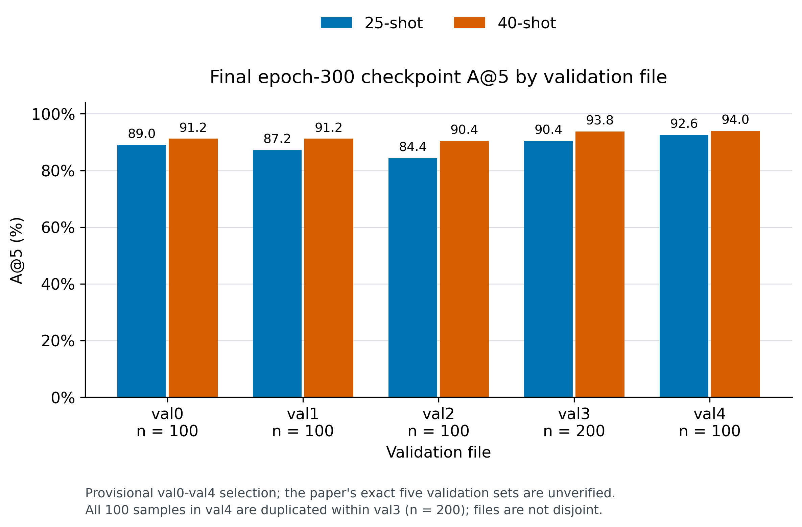

# FMWF-Reproduction

**A B.Tech research reproduction of Tor five-tab, 100-way few-shot website fingerprinting.**

This repository documents two completed experiments using the released FMWF CNN:
200 epochs of synthetic pretraining, followed by separate 300-epoch 25-shot and
40-shot real-traffic fine-tuning runs. It contains our evaluation and diagnostic
utilities, measured aggregate results, final figures, and a 12-page report.

> **Verdict:** metric-matched and broadly configuration-matched, but not fully
> evaluation-protocol-matched. We do not claim exact numerical reproduction or
> an improvement over the original paper.

## Original research and attribution

Wenwen Meng, Chuan Ma, Ming Ding, Chunpeng Ge, Yuwen Qian, and Tao Xiang.
**Beyond Single Tabs: A Transformative Few-Shot Approach to Multi-Tab Website
Fingerprinting Attacks.** WWW 2025, pp. 1068–1077.
[Paper DOI](https://doi.org/10.1145/3696410.3714811) ·
[Official code and dataset instructions](https://github.com/WW-Meng/FMWF)

Audited upstream commit: `c970e0a38710f4bf260b5f63617cb59351af49cb`.
This is a separate reproduction project, not the authors' official repository.
No upstream license or redistribution permission was found in that commit. Author
source, modified author source, raw datasets, and model weights are therefore
excluded. See [licensing and attribution](LICENSING.md) and
[file-level provenance](docs/PROVENANCE.md).

## Main results

All means below use the **final epoch-300 checkpoint** and an **unweighted mean
over provisional val0–val4**. Each input is a float32 `(1, 15000)` direction
sequence; each target has five positives among 100 website labels.

| Configuration | Real support traces | Mean A@5 | Mean exact-set accuracy |
|---|---:|---:|---:|
| 25-shot | 2,500 | **88.72%** | 82.40% |
| 40-shot | 4,000 | **92.12%** | 87.10% |

The paper highlights approximately **91.0% A@5 for Tor five-tab, 25-shot**. Our
25-shot mean is approximately **2.28 percentage points lower**, but that numerical
gap is **not a controlled head-to-head comparison**: the authors' exact five
validation files and checkpoint-selection policy are unverified. The 40-shot
result uses more real training samples and is not a comparison to the 25-shot
headline.

| File | Traces | 25-shot A@5 | 25-shot exact-set | 40-shot A@5 | 40-shot exact-set |
|---|---:|---:|---:|---:|---:|
| val0 | 100 | 89.00% | 82.00% | 91.20% | 87.00% |
| val1 | 100 | 87.20% | 78.00% | 91.20% | 85.00% |
| val2 | 100 | 84.40% | 77.00% | 90.40% | 82.00% |
| val3 | 200 | 90.40% | 85.00% | 93.80% | 90.50% |
| val4 | 100 | 92.60% | 90.00% | 94.00% | 91.00% |

**Overlap:** all 100 rows in val4 also occur in val3. The five files are not
disjoint or independent; 600 row occurrences represent 500 distinct inputs.
Across-file population standard deviation is descriptive spread, not uncertainty
across independent training runs. Do not silently deduplicate or replace sets
when reproducing these particular published aggregates.

## Method and evaluation

FMWF pretrains a CNN and MLP on synthetic multi-tab traffic, then jointly fine-tunes
all parameters on real Tor traffic. The preserved released configuration has
**8,829,156 parameters**, batch size 32, Adam at learning rate 0.001, seed 18,
and `MultiLabelSoftMarginLoss`. The CNN produces raw logits. Validation starts
after epoch 40 and runs after every epoch through 300.

For each trace, **A@5 = number of true websites among the top five scores / 5**;
file scores average over traces. Exact-set accuracy is the fraction of traces
whose entire five-hot prediction equals the target. Both use the same top-five
indices. Four correct sites score 0.8 A@5 and 0 exact-set accuracy. The original
release computed the latter with sklearn's multilabel `accuracy_score`; our
evaluation adds paper-defined A@5 without changing optimization.

## Report and figures

- [12-page reproduction report](reports/FMWF_Reproduction_Report.pdf)
- [Editable report and build instructions](docs/reproduction_report/README.md)
- [Measured CSVs](results/metrics/) and [sanitized run summary](results/run_summary.json)





PNG and vector PDF versions are included. Figure 3 uses the corrected v2 layout.
Publication copies remove machine-specific paths from image/PDF metadata;
PNG pixels and numerical content are unchanged.

## Environment and separate inputs

The completed runs used an operator-reported Apple Silicon MacBook Air with
16 GB unified memory and Python 3.12.16. Logs and evaluation CSVs identify MPS;
the CSVs independently record PyTorch 2.3.0. `requirements.txt` records the
inspected local environment, not a complete historical lockfile for every run.
Exact chip generation, macOS build, and historical non-Torch package versions
were not archived. No CUDA toolkit is required for MPS.

Create your environment and install requirements separately when you choose to
run these utilities. Nothing is installed automatically. Some diagnostics perform
training steps: read [the script guide](docs/REPRODUCIBILITY.md) before execution.

Obtain upstream code separately rather than copying it into this repository:

```bash
git clone https://github.com/WW-Meng/FMWF.git upstream/FMWF
git -C upstream/FMWF checkout --detach c970e0a38710f4bf260b5f63617cb59351af49cb
```

Those commands concern the ignored, separate upstream checkout. This publication
staging directory itself has not been initialized as a Git repository.

Obtain the Tor datasets through the authors' README and review its access terms.
Neither the paper PDF, dataset CSVs nor checkpoints are redistributed here.
The defaults and optional environment overrides are:

```bash
export FMWF_UPSTREAM_DIR="$PWD/upstream/FMWF"
export FMWF_DATASET_DIR="$PWD/data/tor5tab"
export FMWF_CHECKPOINT_DIR="$PWD/checkpoints"
```

Keep `synthesis-5tabdataset.csv`, `tor-5tab-finetuning100way25shot.csv`,
`tor-5tab-finetuning100way40shot.csv`, and the validation CSVs in the dataset
directory. Supply locally obtained/trained weights in the checkpoint directory.
All three input directories are ignored by `.gitignore`.

Evaluate the 25-shot final checkpoint using the provisional default five files:

```bash
python scripts/evaluate_5tab_validation_sets.py \
  --checkpoint "$FMWF_CHECKPOINT_DIR/FMWF_5tab_100way25shot_finetuned300epoch_weights.pth"
```

Omit `--checkpoint` for the 40-shot default. `--validation-files` accepts exactly
five explicit filenames; `--validation-dir` and `--output-dir` remain available.
Output creation is timestamped and exclusive. See the script guide for examples.

## Reproduction boundaries

- Authors' exact evaluation files, checkpoint-selection rule, and independent-run
  policy are not specified by the inspected release.
- The paper describes weighted loss/softmax, while released code uses no explicit
  class weights and raw logits. We followed the released implementation.
- No exact duplicate float32 model inputs were found between either real training
  CSV and any of val0–val12; broader capture independence remains unverifiable.
- Other tab counts, browsers, open-world settings, TMWF, ARES, and Forge were not
  evaluated here. A shared protocol is needed before cross-method comparison.
- A complete training entry point is intentionally not redistributed while upstream
  permissions are unverified. The exact configuration and required local adaptations
  are documented; these utilities do not constitute a turnkey full-training release.

## Publication status and citation

The staging audit, exclusions, privacy checks, and provenance are recorded in
[docs/PUBLICATION_AUDIT.md](docs/PUBLICATION_AUDIT.md). No Git history, remotes,
credentials, raw data, or weights are included. No Git repository was initialized,
and no commit or push was performed.

`CITATION.cff` credits the original paper and uses a contributor-group name rather
than inferring a private identity. Before a public release, the owner should add
their preferred contributor attribution/repository URL and choose licensing terms
for their own contributions. No upstream permission is implied.
