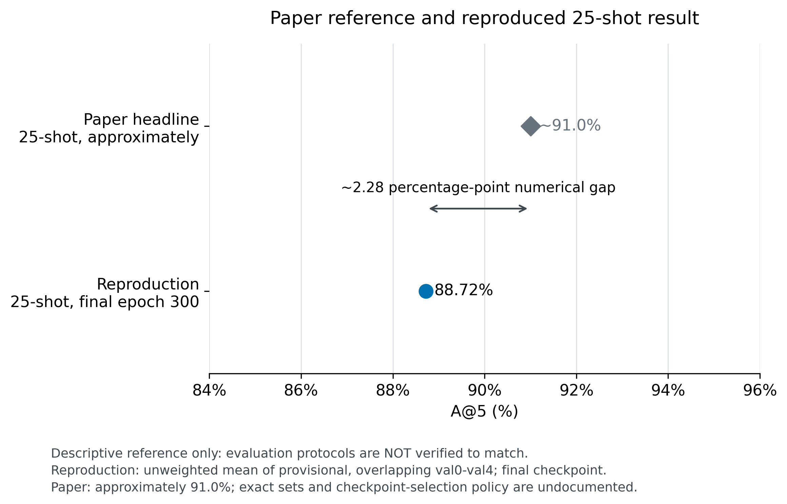

# FMWF — Beyond Single Tabs: A Transformative Few-Shot Approach to Multi-Tab Website Fingerprinting Attacks | Research Reproduction

**An experimental reproduction of [Beyond Single Tabs: A Transformative Few-Shot Approach to Multi-Tab Website Fingerprinting Attacks](https://doi.org/10.1145/3696410.3714811), published at The Web Conference (WWW 2025).**

This repository documents the reproduction and evaluation of **FMWF**, a few-shot learning approach for multi-tab website fingerprinting (WF). FMWF addresses the challenge of identifying multiple websites from overlapping encrypted traffic while reducing dependence on large real multi-tab training datasets. We reproduced the released CNN architecture, completed synthetic pretraining and two real-traffic fine-tuning experiments, and audited the differences between the paper's reported evaluation protocol and its released implementation.

The work was conducted as part of a **B.Tech Computer Science and Engineering research project at Malaviya National Institute of Technology (MNIT), Jaipur**.

This repository contains our independently developed evaluation and diagnostic utilities, numerical results, figures, reproduction documentation, and technical report. Original author training code, raw datasets, and model checkpoints are not redistributed.

**[Full Reproduction Report (PDF)](reports/FMWF_Reproduction_Report.pdf)** | **[Reproducibility Guide](docs/REPRODUCIBILITY.md)** | **[Original Paper](https://doi.org/10.1145/3696410.3714811)** | **[Official Implementation](https://github.com/WW-Meng/FMWF)**

---

## 1. Reproduction Highlights

| Component | Reproduction outcome |
|---|---|
| Model architecture | Original four-block 1D CNN and MLP reproduced |
| Trainable parameters | **8,829,156** |
| Synthetic pretraining | **10,000 traces × 200 epochs — completed** |
| 25-shot fine-tuning | **2,500 real traces × 300 epochs — completed** |
| 40-shot fine-tuning | **4,000 real traces × 300 epochs — completed** |
| 25-shot mean A@5 | **88.72%** |
| 40-shot mean A@5 | **92.12%** |
| Paper's highlighted 25-shot result | **Approximately 91.0% A@5** |
| Hardware | Apple Silicon MacBook Air, 16 GB unified memory, PyTorch MPS |
| Evaluation | Paper-defined A@5 and exact-set accuracy |
| Reproduction status | **Partial reproduction; selected training experiments completed** |

The reproduced 25-shot result is approximately **2.28 percentage points below** the paper's highlighted result.

**Scope qualification:** The paper's exact five validation files and checkpoint-selection policy could not be established. Our five-file evaluation uses a disclosed provisional selection with overlapping records. Consequently, the numerical comparison is **not a strictly protocol-matched benchmark**.

---

## 2. Original Research Paper

| Field | Details |
|---|---|
| Title | Beyond Single Tabs: A Transformative Few-Shot Approach to Multi-Tab Website Fingerprinting Attacks |
| Authors | Wenwen Meng, Chuan Ma, Ming Ding, Chunpeng Ge, Yuwen Qian, Tao Xiang |
| Conference | Proceedings of The Web Conference (WWW 2025) |
| Pages | 1068–1077 |
| DOI | [10.1145/3696410.3714811](https://doi.org/10.1145/3696410.3714811) |
| Official repository | [WW-Meng/FMWF](https://github.com/WW-Meng/FMWF) |
| Audited upstream commit | `c970e0a38710f4bf260b5f63617cb59351af49cb` |
| This reproduction | [tanikaaaa/FMWF-Reproduction](https://github.com/tanikaaaa/FMWF-Reproduction) |

The original model architecture, pretraining strategy, and few-shot learning method belong to the paper's authors. This repository documents our independent implementation, execution, verification, and reproducibility analysis of their released approach.

---

## 3. Research Overview

### Website fingerprinting in Tor

Website fingerprinting attempts to infer which websites a user visits by analyzing characteristics of encrypted network traffic.

Although Tor encrypts and routes communication through multiple relays, observable traffic features—including packet direction, order, and communication patterns—can still contain information about visited websites.

In the conventional **single-tab** setting, a traffic trace generally corresponds to one website. This allows a classifier to predict one website label for each observed sequence.

Real browsing is more complicated.

A user can open several tabs concurrently, producing a combined traffic trace containing contributions from multiple websites. The classifier must therefore predict multiple website labels from one observation.

### Why multi-tab fingerprinting is challenging

Multi-tab traffic introduces several difficulties:

1. **Overlapping traffic:** Packets belonging to different websites appear in a shared observation.
2. **Variable browsing behavior:** Website loading and packet ordering differ across browsing sessions.
3. **Multilabel classification:** A single trace can correspond to several visited websites.
4. **Data collection costs:** Collecting representative real traffic for many website combinations is expensive.
5. **Synthetic-to-real differences:** Artificially combined traces do not perfectly reproduce real overlapping traffic.

Earlier methods address aspects of traffic modeling and multi-tab classification, but reliance on substantial real multi-tab training data remains a practical challenge.

### FMWF's objective

FMWF aims to reduce the amount of real multi-tab training data required by using **synthetic pretraining followed by few-shot real-traffic adaptation**.

The relevant threat model is a passive observer analyzing encrypted traffic patterns and attempting to identify visited websites. Our reproduced experiment uses a known 100-website label space in a Tor closed-world setting.

---

## 4. Core Method and Model Architecture

### 4.1 Two-stage learning strategy

FMWF separates model learning into two stages.

**Stage 1 — Synthetic pretraining**

Single-tab traffic traces are combined into synthetic multi-tab observations. The model learns traffic representations and multilabel prediction from a relatively large synthetic dataset.

**Stage 2 — Few-shot real-traffic fine-tuning**

The pretrained model is initialized with the learned weights and adapted using a smaller real multi-tab dataset.

For our reproduction, the two fine-tuning configurations were trained independently from the same pretrained checkpoint.

### 4.2 Experimental pipeline

```text
             Single-tab Tor traffic
                       |
                       v
         Synthetic multi-tab construction
                       |
                       v
          Synthetic 5-tab training CSV
                10,000 samples
                       |
                       v
              CNN + MLP pretraining
                  200 epochs
                       |
                       v
            Pretrained model weights
                       |
             +---------+---------+
             |                   |
             v                   v
       25-shot training     40-shot training
        2,500 samples        4,000 samples
             |                   |
             v                   v
       Fine-tuning          Fine-tuning
        300 epochs           300 epochs
             |                   |
             v                   v
       Final epoch-300     Final epoch-300
         checkpoint          checkpoint
             |                   |
             +---------+---------+
                       |
                       v
            Real 5-tab validation
                 val0–val4
                       |
                       v
               100 output logits
                       |
                       v
             Top-5 website selection
                       |
                       v
           A@5 + exact-set accuracy
```

We used the **official pre-generated synthetic CSV**. We did not independently reconstruct the complete original synthetic-data generation pipeline, whose detailed provenance is not fully available in the inspected release.

### 4.3 Input representation

Each traffic sample is represented using a fixed-length sequence of **15,000 packet-direction features**.

The representation uses:

- `+1` for one packet direction;
- `-1` for the opposite direction;
- `0` for padding.

The model input is:

```text
(batch_size, 1, 15000)
```

The target is a 100-dimensional multi-hot vector, with five positive labels in the real five-tab experiments.

The model outputs:

```text
(batch_size, 100)
```

Each output represents a website score.

### 4.4 CNN architecture

The released architecture contains four convolutional blocks followed by dense layers.

| Layer | Architecture | Output shape |
|---|---|---|
| Input | Packet-direction sequence | `(B, 1, 15000)` |
| Conv Block 1 | Conv1D 1→32→32, ELU | `(B, 32, 3749)` |
| Conv Block 2 | Conv1D 32→64→64, ReLU | `(B, 64, 936)` |
| Conv Block 3 | Conv1D 64→128→128, ReLU | `(B, 128, 233)` |
| Conv Block 4 | Conv1D 128→256→256, ReLU | `(B, 256, 57)` |
| Flatten | 256 × 57 features | `(B, 14592)` |
| Dense 1 | Linear 14592→512, BatchNorm, ReLU, Dropout 0.7 | `(B, 512)` |
| Dense 2 | Linear 512→512, BatchNorm, ReLU, Dropout 0.3 | `(B, 512)` |
| Output | Linear 512→100 | `(B, 100)` |

Each convolutional block contains two convolutional layers with batch normalization and activation, followed by max pooling. The convolutional layers use kernel size 8, stride 1, and padding 4. Pooling uses kernel size 8 and stride 4; block dropout is 0.1.

**Verified trainable parameters: 8,829,156.**

The model does not explicitly reconstruct or separate the traffic stream corresponding to each individual tab. Instead, the entire combined sequence is processed for multilabel prediction.

### 4.5 Training objective

The released implementation uses:

```python
torch.nn.MultiLabelSoftMarginLoss()
```

During fine-tuning, the complete CNN and classifier are updated jointly.

The model outputs raw logits. During evaluation, websites are ranked by output score, and the five highest-scoring labels are selected.

Applying softmax would preserve this ranking, but the released training code does not apply a final softmax.

---

## 5. Dataset and Experimental Pipeline

### 5.1 Original dataset source

We used the Tor multi-tab datasets released through the [official FMWF repository](https://github.com/WW-Meng/FMWF).

The paper includes additional experiments involving multiple tab counts, browser environments, and open-world conditions. This reproduction focuses on the **Tor, five-tab, closed-world, 100-way** setting.

The complete official dataset archive was approximately 455 MiB compressed and approximately 11 GB after extraction.

**Neither the complete dataset nor the raw traffic traces are redistributed in this repository.**

### 5.2 Datasets actually used

| Experiment | Original CSV filename | Samples used | Input length | Labels |
|---|---|---:|---:|---:|
| Synthetic pretraining | `synthesis-5tabdataset.csv` | 10,000 | 15,000 | 100 |
| Real 25-shot fine-tuning | `tor-5tab-finetuning100way25shot.csv` | 2,500 | 15,000 | 100 |
| Real 40-shot fine-tuning | `tor-5tab-finetuning100way40shot.csv` | 4,000 | 15,000 | 100 |

**Dataset reduction:** None. All rows of the respective released training CSVs were used.

The 25-shot and 40-shot datasets are separate fine-tuning configurations, not a conventional random 25%/40% train split.

The inspected real support datasets contain 100 distinct five-website label combinations, with 25 or 40 examples per combination.

### 5.3 CSV preprocessing

The synthetic CSV contains:

```text
[100 multi-hot label columns] [15000 traffic columns]
```

Shape:

```text
(10000, 15100)
```

The real fine-tuning CSVs contain:

```text
[100 multi-hot label columns] [6 metadata columns] [15000 traffic columns]
```

Shapes:

```text
25-shot: (2500, 15106)
40-shot: (4000, 15106)
```

The released scripts read CSV files with `header=None`.

For synthetic data:

```python
labels = df.iloc[:, :100]
features = df.iloc[:, 100:]
```

For real multi-tab data:

```python
labels = df.iloc[:, :100]
features = df.iloc[:, 106:]
```

Features are converted to `float32` and reshaped into the model's expected tensor format.

No additional traffic feature extractor, sequence-length reduction, or packet-direction transformation was introduced in our completed training experiments.

### 5.4 Validation datasets

The release contains validation files `tor5tab-dataset-val0.csv` through `tor5tab-dataset-val12.csv`.

During training, the released five-tab procedure evaluates `val0`.

For final-checkpoint analysis, our evaluator uses the provisional five-file selection:

| Validation file | Samples |
|---|---:|
| `val0` | 100 |
| `val1` | 100 |
| `val2` | 100 |
| `val3` | 200 |
| `val4` | 100 |
| **Total row occurrences** | **600** |

**Important dataset-integrity finding:** All 100 records in `val4` are also contained in `val3`.

Therefore, the selected files contain only **500 distinct traffic inputs across 600 row occurrences**.

They must not be described as five independent or disjoint evaluation sets.

A separate audit found no exact duplicate float32 traffic inputs between either real training dataset and any of the 13 validation files. This does not prove complete collection-session independence.

The exact five validation files used by the paper's authors remain unidentified.

### 5.5 Training and evaluation separation

- **Synthetic CSV:** Pretraining only.
- **25-shot real CSV:** Fine-tuning the 25-shot model.
- **40-shot real CSV:** Fine-tuning the 40-shot model.
- **val0:** Repeated validation during fine-tuning.
- **val0–val4:** Final-checkpoint evaluation under our provisional selection.

No separately established, untouched real-traffic test-set metric is reported in this reproduction.

---

## 6. Implementation Environment

Experiments were executed locally on an Apple Silicon MacBook Air.

| Component | Configuration |
|---|---|
| Operating system | macOS |
| Processor architecture | Apple Silicon / ARM64 |
| Unified memory | 16 GB |
| Python | 3.12.16 |
| PyTorch | 2.3.0 |
| NumPy | 1.26.4 |
| pandas | 2.2.2 |
| scikit-learn | 1.5.1 |
| matplotlib | 3.9.2 |
| psutil | 7.2.2 |
| Training backend | PyTorch MPS |
| Environment | Python virtual environment |

These dependency versions reflect the inspected local environment; not every package's historical version was independently preserved for every training run.

The original repository documents an Ubuntu 22.04 environment with an NVIDIA RTX 3080 Ti, CUDA 12.1, Python 3.12, and PyTorch 2.3.0.

Our implementation required adapting the CUDA-oriented execution paths to Apple's Metal Performance Shaders backend.

The original model size, batch size, training duration, and dataset sizes were preserved.

---

## 7. Training and Evaluation Configuration

### 7.1 Hyperparameters

| Parameter | Synthetic pretraining | Real fine-tuning |
|---|---:|---:|
| Input length | 15,000 | 15,000 |
| Output dimensions | 100 | 100 |
| Batch size | 32 | 32 |
| Epochs | 200 | 300 |
| Learning rate | 0.001 | 0.001 |
| Optimizer | Adam | Adam |
| Loss | MultiLabelSoftMarginLoss | MultiLabelSoftMarginLoss |
| Random seed | 18 | 18 |
| Scheduler | None | None |
| Early stopping | None | None |
| Trainable parameters | Entire model | Entire model |

Both fine-tuning runs initialized from the same pretrained weights, independently of one another.

Fine-tuning used a new Adam optimizer. The optimizer state from pretraining was not resumed.

The last batch of the 25-shot experiment contained four samples; the 40-shot dataset produced 125 full batches per epoch.

### 7.2 Checkpoint policy

The original fine-tuning implementation records validation performance but does not implement a documented best-checkpoint selection rule.

Our reproduction explicitly saved the **final epoch-300 model weights** for each configuration.

All final multi-file results in this README refer to those final checkpoints, not the maximum values observed during training.

### 7.3 Evaluation metrics

We report two distinct metrics.

#### A@5 — Paper-defined metric

For each sample, the model selects the five highest-scoring website labels.

A@5 measures the fraction of those five predictions that correspond to true visited websites:

$$
A@5(x)=\frac{1}{5}\sum_{i\in\operatorname{Top5}(z(x))}y_i
$$

where:

- \(z(x)\) is the model's 100-dimensional output;
- \(y_i\) indicates whether website \(i\) was visited;
- \(\operatorname{Top5}\) returns the five highest-scoring website indices.

For example, predicting four of the five correct websites gives:

```text
A@5 = 4/5 = 80%
```

#### Exact-set accuracy — Released-code metric

The original five-tab implementation uses scikit-learn's multilabel `accuracy_score`.

For multilabel indicator matrices, this computes exact-set accuracy: **all five predicted labels must match the target** for the sample to count as correct.

For example:

```text
4 of 5 correct websites:

A@5                = 80%
Exact-set accuracy = 0%
```

This difference is significant.

Our evaluator retains exact-set accuracy and adds the paper-defined A@5 metric without modifying the model's training procedure.

### 7.4 Five-file aggregation

We report the unweighted average of the five selected validation-file scores:

$$
\overline{A@5}=\frac{1}{5}\sum_{j=0}^{4}A@5_j
$$

The 200-sample `val3` file receives the same file-level weight as each 100-sample file.

Population standard deviations describe variation between these file scores. They are **not confidence intervals or estimates of variation across independently trained models**.

---

## 8. Experimental Results

This section reports completed experiments and saved evaluation results.

### 8.1 Main reproduction comparison

The paper highlights approximately **91.0% A@5** for its Tor five-tab, 100-way, 25-shot closed-world experiment.

Our corresponding 25-shot model achieved **88.72% mean A@5** under the provisional five-file evaluation.

| Metric | Published paper | Our reproduction | Difference |
|---|---:|---:|---:|
| Tor 5-tab, 25-shot A@5 | ≈91.00% | **88.72%** | ≈−2.28 percentage points |

Approximate relative difference:

$$
\frac{88.72-91.00}{91.00}\times100\approx-2.51\%
$$

**Comparison caveat:** The paper's precise validation-file selection and checkpoint policy are unknown. The reported gap is a descriptive numerical difference, not a controlled or statistically established performance deficit.



*Figure 1. Published headline versus reproduced 25-shot result. The reproduction uses final epoch-300 weights and a provisional, overlapping five-file validation selection; exact evaluation-protocol equivalence is not established.*

### 8.2 Final 25-shot and 40-shot results

Both fine-tuning configurations completed all 300 epochs.

| Configuration | Real training samples | Mean A@5 | Mean exact-set accuracy |
|---|---:|---:|---:|
| **25-shot** | 2,500 | **88.72%** | **82.40%** |
| **40-shot** | 4,000 | **92.12%** | **87.10%** |

The 40-shot model achieved:

- **+3.40 percentage points** higher mean A@5;
- **+4.70 percentage points** higher mean exact-set accuracy.

This is an internal comparison under our shared evaluation procedure. It does not establish a statistically significant performance improvement from additional training samples.

### 8.3 Per-validation-file performance

All values below were obtained from saved **epoch-300 checkpoints**.

| Validation file | Samples | 25-shot A@5 | 25-shot exact-set | 40-shot A@5 | 40-shot exact-set |
|---|---:|---:|---:|---:|---:|
| val0 | 100 | 89.00% | 82.00% | 91.20% | 87.00% |
| val1 | 100 | 87.20% | 78.00% | 91.20% | 85.00% |
| val2 | 100 | 84.40% | 77.00% | 90.40% | 82.00% |
| val3 | 200 | 90.40% | 85.00% | 93.80% | 90.50% |
| val4 | 100 | 92.60% | 90.00% | 94.00% | 91.00% |
| **Unweighted mean** | — | **88.72%** | **82.40%** | **92.12%** | **87.10%** |

Across-file population standard deviations:

| Metric | 25-shot | 40-shot |
|---|---:|---:|
| A@5 | 2.79 percentage points | 1.48 percentage points |
| Exact-set accuracy | 4.76 percentage points | 3.38 percentage points |


*Figure 2. Final-checkpoint A@5 across provisional validation files. `val3` contains 200 records and includes all 100 `val4` records; the files are not independent evaluation sets.*

### 8.4 A@5 throughout fine-tuning

Validation A@5 was recorded from epoch 40 through epoch 300, producing **261 epoch-level observations** per configuration.

| Configuration | Final val0 A@5 | Best observed val0 A@5 | Best epoch |
|---|---:|---:|---|
| 25-shot | 89.00% | 91.80% | 187, 189 |
| 40-shot | 91.20% | 94.80% | 233 |


*Figure 3. Unsmoothed A@5 on `val0` during 25-shot and 40-shot fine-tuning. Best-observed validation values are shown separately from final-checkpoint performance.*

The best observed validation epochs were **not saved as separate best-epoch checkpoints**.

We therefore do not substitute 91.80% or 94.80% for the final model's five-file evaluation results.

### 8.5 Exact-set accuracy throughout fine-tuning

| Configuration | Final val0 exact-set | Best observed val0 exact-set | Best epoch |
|---|---:|---:|---|
| 25-shot | 82.00% | 86.00% | 149, 282 |
| 40-shot | 87.00% | 92.00% | 237 |


*Figure 4. Unsmoothed exact-set accuracy computed using the original released-code metric. It requires all five website labels to be predicted correctly.*

The difference between A@5 and exact-set accuracy illustrates the importance of choosing the correct evaluation definition for multilabel website fingerprinting.

### 8.6 Synthetic pretraining

Synthetic pretraining completed **200 epochs** on the released 10,000-sample synthetic CSV.

Final logged training metrics:

| Metric | Final synthetic training result |
|---|---:|
| Training loss | 0.0005 |
| Exact-set accuracy | 98.84% |
| Precision | 99.91% |
| Recall | 99.83% |
| F1-score | 99.85% |

These are **synthetic training metrics** and are not representative of independently held-out real multi-tab traffic.

We do not claim corresponding real-traffic precision, recall, or F1 scores because those were not independently measured in the completed final evaluations.

---

## 9. Key Experimental Findings

### 1. Two-stage reproduction completed

The original released CNN architecture was retained, and synthetic pretraining followed by real few-shot fine-tuning was completed without reducing the stated epoch counts, training sample counts, batch size, or sequence length.

### 2. The reproduced 25-shot metric is numerically close to the paper's headline

The reproduced five-file mean was 88.72% A@5 against an approximately 91.0% published reference.

However, unidentified validation mapping and checkpoint selection prevent a strict paper-to-reproduction equivalence claim.

### 3. More real training samples corresponded to higher validation performance

The 40-shot configuration achieved a 3.40-percentage-point higher mean A@5 than the 25-shot configuration under our common evaluation procedure.

Only one completed training trajectory per configuration is documented, so this observation is not a statistical scaling result.

### 4. Evaluation metric definitions materially affect interpretation

The released code's exact-set accuracy is stricter than the paper's A@5 metric.

For the 25-shot final model, the two mean scores were:

```text
A@5:                88.72%
Exact-set accuracy: 82.40%
```

Reporting exact-set accuracy as the paper's A@5 would therefore misrepresent the reproduction.

### 5. Validation-file integrity requires explicit reporting

All 100 rows of `val4` appear inside `val3`.

This means five selected validation files do not provide five independent sample sets, and repeated samples influence the unweighted aggregate.

### 6. Checkpoint selection matters

The highest observed single-file A@5 occurred earlier than epoch 300 in both fine-tuning experiments.

The released code does not establish the authors' checkpoint-selection rule. We consistently report final-epoch checkpoints rather than selecting validation maxima to improve numerical agreement.

### 7. Full-size training was feasible on Apple Silicon

The reproduction completed on a 16 GB Apple Silicon machine through the MPS backend without an architecture reduction or dataset subsampling.

This demonstrates feasibility for the selected experiment, but is not a benchmark of Apple MPS against NVIDIA CUDA.

---

## 10. Implementation Challenges and Modifications

| Challenge / Modification | Released implementation | Reproduction approach | Classification |
|---|---|---|---|
| Device execution | CUDA-oriented | Added MPS/CPU compatibility | Compatibility |
| CUDA-specific seeding | CUDA assumptions | Guarded CUDA seed calls | Compatibility |
| Dataset paths | Environment-specific paths | Configurable local paths | Compatibility |
| Checkpoint loading | Environment-dependent | Added device-aware loading | Compatibility |
| Smoke testing | Training scripts execute substantial work at import | Added isolated architecture tests | Testing |
| Missing fine-tuned checkpoint output | No documented epoch-300 fine-tuned checkpoint save | Added explicit final checkpoint saving | Experimental infrastructure |
| 25-shot experiment | Released five-tab entry point centered on 40-shot | Adapted training script for official 25-shot CSV | Experimental extension |
| Evaluation metric | Multilabel exact-set accuracy | Added paper-defined A@5 while retaining exact-set | Evaluation correction |
| Evaluation coverage | Single validation file in released entry point | Added five-file evaluation | Experimental deviation |
| Validation selection | Exact author mapping unidentified | Provisional `val0`–`val4` | Experimental deviation |
| Model selection | Author policy undocumented | Explicit epoch-300 checkpoints | Experimental choice |
| Reproducibility documentation | Incomplete local execution provenance | Added audits, figures, manifests, and report | Documentation |

### Model-preserving changes

The architecture, trainable parameter count, optimizer, loss function, learning rate, batch size, random seed, input length, and training duration were preserved relative to the released executable configuration.

### Changes affecting comparability

The **provisional validation-file selection** and **final-checkpoint policy** are the main unresolved experimental-protocol differences.

The added A@5 metric corrects a definition mismatch, but does not resolve unknown author evaluation decisions.

### Memory and timing checks

Diagnostic tests performed before full training included:

| Probe | Observation |
|---|---|
| Synthetic one-epoch full-data test | 10,000 samples, 313 batches |
| Synthetic process RSS | Approximately 3.912 GiB |
| 40-shot one-epoch test | 4,000 samples, 125 batches |
| 40-shot diagnostic training time | 16.48 seconds |
| 40-shot process RSS | Approximately 1.877 GiB |
| 25-shot one-epoch test | 2,500 samples, 79 batches |
| 25-shot diagnostic training time | 10.77 seconds |

These are recorded diagnostic observations, not complete full-run benchmarks. Raw historical console transcripts of some probes were not preserved.

Apple unified-memory process RSS and MPS allocation measurements cannot simply be added together.

---

## 11. Repository Structure

This public repository contains independently created reproduction utilities and documentation, not a copy of the upstream authors' implementation.

```text
FMWF-Reproduction/
|
|-- README.md
|-- LICENSING.md
|-- CITATION.cff
|-- requirements.txt
|-- .gitignore
|
|-- scripts/
|   |-- reproduction_paths.py
|   |-- evaluate_5tab_validation_sets.py
|   |-- plot_final_reproduction_results.py
|   |-- smoke_test_model.py
|   |-- smoke_test_pretraining.py
|   |-- smoke_test_finetuning.py
|   |-- smoke_test_25shot_full_epoch.py
|   |-- smoke_test_validation.py
|   |-- test_full_dataset_memory.py
|   `-- test_full_finetuning_memory.py
|
|-- results/
|   |-- figures/
|   |   |-- figure_1_val0_a_at_5_by_epoch.png
|   |   |-- figure_1_val0_a_at_5_by_epoch.pdf
|   |   |-- figure_2_val0_exact_set_accuracy_by_epoch.png
|   |   |-- figure_2_val0_exact_set_accuracy_by_epoch.pdf
|   |   |-- figure_3_final_a_at_5_by_validation_file_v2.png
|   |   |-- figure_3_final_a_at_5_by_validation_file_v2.pdf
|   |   |-- figure_4_paper_reference_vs_reproduction_25shot.png
|   |   `-- figure_4_paper_reference_vs_reproduction_25shot.pdf
|   |
|   |-- metrics/
|   |   |-- 100way-25shot-validation_accuracy-300epoch.csv
|   |   |-- 100way-40shot-validation_accuracy-300epoch.csv
|   |   `-- FMWF_*_evaluation_*.csv
|   |
|   `-- run_summary.json
|
|-- reports/
|   `-- FMWF_Reproduction_Report.pdf
|
`-- docs/
    |-- PROVENANCE.md
    |-- PUBLICATION_AUDIT.md
    |-- PUBLICATION_MANIFEST.json
    |-- REPRODUCIBILITY.md
    |
    `-- reproduction_report/
        |-- report.md
        |-- build_report.py
        |-- collect_evidence.py
        |-- evidence.json
        |-- verification.json
        `-- README.md
```

### Files intentionally excluded

The public repository does **not** contain:

- Raw Tor datasets or the approximately 11 GB extracted dataset archive.
- Pretrained or fine-tuned model weights.
- Original or modified author training source files.
- The derivative 25-shot training script.
- Virtual environments or cached dependencies.
- Raw training logs.
- The original published paper PDF.
- Superseded result figures.

This separation avoids unnecessary file distribution and respects the unresolved upstream redistribution permissions.

See [Licensing and Attribution](LICENSING.md) and [Provenance](docs/PROVENANCE.md).

---

## 12. Reproduction Instructions

**Important:** This public repository is a reproduction-results and tooling repository. It is **not a fully self-contained training release**.

The original training scripts and datasets must be obtained separately from the authors' repository. The local reproduction involved compatibility modifications that are documented but whose derivative training files are not redistributed here.

The commands below distinguish the original completed local workflow from instructions that require local preparation. A fresh-machine end-to-end run has not been independently validated.

### 12.1 Clone this repository

```bash
git clone https://github.com/tanikaaaa/FMWF-Reproduction.git
cd FMWF-Reproduction
```

### 12.2 Create a Python environment

For a Python 3.12 environment:

```bash
python3 -m venv .venv
source .venv/bin/activate

python -m pip install -r requirements.txt
```

The `requirements.txt` file records dependencies inspected during the reproduction.

A clean installation may require platform-specific PyTorch handling. These instructions have not been verified across all operating systems and hardware.

### 12.3 Obtain the original source

Clone the original authors' repository separately:

```bash
git clone https://github.com/WW-Meng/FMWF.git FMWF-upstream

cd FMWF-upstream
git checkout c970e0a38710f4bf260b5f63617cb59351af49cb
cd ..
```

The original implementation includes the CNN pretraining and five-tab fine-tuning scripts.

Refer to the [official upstream repository](https://github.com/WW-Meng/FMWF) for the authors' dataset download instructions.

### 12.4 Prepare the datasets

Download and extract the original Tor dataset separately.

The selected files required by our experiment were:

```text
tor5tab/
|-- synthesis-5tabdataset.csv
|-- tor-5tab-finetuning100way25shot.csv
|-- tor-5tab-finetuning100way40shot.csv
|-- tor5tab-dataset-val0.csv
|-- tor5tab-dataset-val1.csv
|-- tor5tab-dataset-val2.csv
|-- tor5tab-dataset-val3.csv
`-- tor5tab-dataset-val4.csv
```

The original release contains additional validation files and datasets.

No custom feature-extraction step was required for our final experiments because these files already contain the fixed-length traffic representations.

The public tooling uses configurable paths; consult [Reproducibility Instructions](docs/REPRODUCIBILITY.md) and `scripts/reproduction_paths.py`.

### 12.5 Pretraining

The completed local experiment used the original training entry point after adapting device and file paths:

```bash
python -u FMWF-src/PretrainingModel.py \
  2>&1 | tee fmwf_pretraining.log
```

This command was executed in the original **local FMWF working project**, not in the public `FMWF-Reproduction` repository.

It requires the separately obtained upstream source, official dataset, and local compatibility changes.

The training completed 200 epochs and produced pretrained model weights.

### 12.6 Fine-tuning

The original local 40-shot experiment was executed using:

```bash
python -u FMWF-src/tor-5tab-Accuracy.py \
  2>&1 | tee fmwf_5tab_finetuning.log
```

The separate 25-shot run used:

```bash
python -u FMWF-src/tor-5tab-25shot-Accuracy.py \
  2>&1 | tee fmwf_5tab_25shot_finetuning.log
```

The 25-shot script was created as a derivative of the upstream implementation and is **not committed to this public repository**.

These commands document the completed local experiment. They are not direct executable commands from a fresh clone of this results repository.

Both runs used the pretrained state dictionary and completed 300 epochs.

### 12.7 Final-checkpoint evaluation

Our independent evaluator is included at:

```text
scripts/evaluate_5tab_validation_sets.py
```

It computes:

- Paper-defined A@5;
- Multilabel exact-set accuracy;
- File-level results;
- Unweighted five-file means;
- Across-file population standard deviations.

Evaluation requires:

1. The official validation CSVs.
2. The saved fine-tuned checkpoint.
3. Access to the upstream model architecture.
4. Correct local input paths.

Because checkpoints and original model classes are excluded, cloning this repository alone is not sufficient to rerun inference.

Consult [docs/REPRODUCIBILITY.md](docs/REPRODUCIBILITY.md) for the prepared tool's configuration.

### 12.8 Inspect the existing results

Training curves and final measurements are already available without rerunning the model:

- [25-shot validation curve CSV](results/metrics/100way-25shot-validation_accuracy-300epoch.csv)
- [40-shot validation curve CSV](results/metrics/100way-40shot-validation_accuracy-300epoch.csv)
- [Run summary](results/run_summary.json)
- [Figures](results/figures/)
- [Full report](reports/FMWF_Reproduction_Report.pdf)

The full report contains numerical tables, architecture details, evaluation definitions, experimental provenance, and methodological limitations.

---

## 13. Reproduction Status

**Status: Partial reproduction — full selected training experiments completed, but exact paper-level evaluation protocol not established.**

The released CNN architecture, 200-epoch synthetic pretraining, and both 300-epoch real few-shot fine-tuning experiments were reproduced using the official corresponding training CSVs.

We implemented the paper-defined A@5 metric and evaluated final model checkpoints under a documented five-file procedure. The 25-shot model achieved 88.72% mean A@5, compared with the paper's approximately 91.0% headline.

However, the original validation-file mapping, checkpoint-selection policy, and complete split-generation provenance could not be established. Only the selected Tor five-tab closed-world experiments were reproduced, not the paper's full experimental suite.

**Assessment: Metric-matched and broadly configuration-matched, but not fully evaluation-protocol-matched.**

---

## 14. Scientific Limitations

### 14.1 Limitations associated with the research setting

The original research addresses limitations of training multi-tab website fingerprinting classifiers with scarce real overlapping traffic.

Relevant challenges include:

- The cost of collecting sufficient realistic multi-tab traces.
- Differences between synthetically combined and genuinely overlapping traffic.
- Dependence on representative traffic from the target browsing environment.
- The difficulty of generalizing across website populations, tab configurations, and browsing behaviors.

These are supported by the paper's motivation and experimental scope; they should not all be interpreted as explicitly labeled limitations acknowledged by the authors.

### 14.2 Limitations identified during reproduction

**Validation protocol uncertainty**

The paper describes averaging across five validation sets, but the inspected code does not identify the exact five files.

**Overlapping validation records**

The provisional `val0`–`val4` selection contains duplicate traffic inputs because all of `val4` is included in `val3`.

**Paper-versus-code metric mismatch**

The paper's A@5 definition differs from the released implementation's exact-set accuracy calculation.

**Undocumented checkpoint policy**

The original implementation does not establish how the authors selected the checkpoint used for their published result.

**Paper-versus-code implementation differences**

The paper discusses weighted loss and softmax, whereas the released executable training code uses unweighted `MultiLabelSoftMarginLoss` and raw logits.

**Incomplete dataset provenance**

The complete Tor trace-generation, split-construction, and capture-session mapping could not be reconstructed from the inspected release.

**Single documented training trajectory per configuration**

One complete 25-shot run and one complete 40-shot run are documented. No multi-seed statistical evaluation was established.

**Restricted experimental scope**

Our reproduction covers only the Tor five-tab closed-world configuration. Open-world, alternative browser, other tab-count, and unknown-tab-count experiments were not reproduced.

**No independently untouched test-set benchmark**

The reported results are validation metrics. No separately established untouched test set was evaluated.

**No full public checkpoint release**

Model weights and raw training datasets are excluded from this publication. The repository preserves aggregate measurements, plots, reproducibility utilities, and a detailed report, but not a fully executable training bundle.

### 14.3 Why the numerical difference remains unresolved

The reproduced 25-shot result differs from the paper's headline by approximately 2.28 percentage points.

Possible contributors include validation-file choice, checkpoint selection, training randomness, and hardware/backend numerical differences.

However, the available evidence does not establish which factor caused the difference.

In particular, it would be incorrect to attribute the gap to Apple MPS or claim model underperformance without a controlled evaluation under the authors' exact protocol.

---

## 15. Student Reproduction Contributions

The contributions of this reproduction project are separate from the original FMWF research contribution.

### Implementation and execution

- Adapted CUDA-oriented model execution to PyTorch MPS on Apple Silicon.
- Corrected environment-specific dataset and checkpoint paths.
- Verified compatibility of the original CNN architecture and pretrained state dictionaries.
- Completed 200-epoch synthetic pretraining.
- Completed independent 300-epoch fine-tuning runs for official 25-shot and 40-shot Tor datasets.
- Added and validated final fine-tuned checkpoint saving.

### Evaluation and reproducibility

- Identified the difference between paper-defined A@5 and released-code exact-set accuracy.
- Implemented an independent evaluator reporting both metrics.
- Evaluated saved final checkpoints across five explicitly selected validation files.
- Audited validation-file overlap and training/validation exact-input duplication.
- Preserved final metrics and epoch-level validation curves.
- Performed memory and numerical feasibility tests on Apple Silicon.
- Inspected architecture consistency and checkpoint state-dictionary compatibility.

### Scientific documentation

- Produced four results figures, including training curves and paper-versus-reproduction comparison.
- Prepared an evidence-based 12-page technical reproduction report.
- Documented protocol gaps, environment limitations, and incomplete provenance.
- Created a standalone publication bundle with portable utilities, results, manifests, attribution, and reproducibility instructions.

No original FMWF architecture or synthetic-to-real few-shot learning idea is claimed as a new contribution of this repository.

---

## 16. Research Directions

The completed reproduction suggests several directions for further investigation.

### Evaluation standardization

Establish explicit and non-overlapping train, validation, and test splits, together with a consistent A@K implementation and predetermined checkpoint-selection policy.

### Support-set efficiency

Measure how performance varies with real support-set size under identical data partitions and multiple training seeds.

### Synthetic-to-real transfer

Compare synthetic pretraining with training only on real traffic under matched data and computation budgets.

### Tab-count generalization

Study whether representations trained for one number of concurrent tabs transfer effectively to other tab-count settings.

### Cross-method comparison

Evaluate FMWF against other multi-tab website fingerprinting approaches under a shared dataset, preprocessing representation, label space, and evaluation protocol.

These are possible research directions, not established novel contributions. Novelty requires further literature review and controlled experimentation.

---

## 17. References, Attribution, and Licensing

### Original paper

Wenwen Meng, Chuan Ma, Ming Ding, Chunpeng Ge, Yuwen Qian, and Tao Xiang.

**Beyond Single Tabs: A Transformative Few-Shot Approach to Multi-Tab Website Fingerprinting Attacks.**

*Proceedings of The Web Conference (WWW 2025)*, pp. 1068–1077.

DOI: https://doi.org/10.1145/3696410.3714811

### Official implementation

https://github.com/WW-Meng/FMWF

Audited base commit:

```text
c970e0a38710f4bf260b5f63617cb59351af49cb
```

### Reproduction repository

https://github.com/tanikaaaa/FMWF-Reproduction

### Frameworks

- [PyTorch](https://pytorch.org/)
- [NumPy](https://numpy.org/)
- [pandas](https://pandas.pydata.org/)
- [scikit-learn](https://scikit-learn.org/)
- [Matplotlib](https://matplotlib.org/)

### Licensing and redistribution

No affirmative upstream redistribution license was identified at the inspected FMWF commit.

Therefore, this repository excludes the original authors' source code, modified upstream training scripts, raw datasets, and model weights.

Users should obtain the upstream implementation and official data directly from the original authors.

No project-wide license for the independent reproduction contributions has yet been selected. See [LICENSING.md](LICENSING.md) for the precise current status.

---

## 18. Final Reproduction Summary

| Item | Final outcome |
|---|---|
| Research paper | FMWF, WWW 2025 |
| Problem | Multi-tab Tor website fingerprinting with limited real training data |
| Model | Four-block 1D CNN + MLP |
| Trainable parameters | 8,829,156 |
| Dataset | Official Tor five-tab synthetic and real traffic |
| Synthetic pretraining | 10,000 samples, 200 epochs — completed |
| 25-shot fine-tuning | 2,500 real samples, 300 epochs — completed |
| 40-shot fine-tuning | 4,000 real samples, 300 epochs — completed |
| Hardware | Apple Silicon MacBook Air, 16 GB, MPS |
| Paper result | Approximately 91.0% A@5, Tor five-tab 25-shot |
| Reproduced 25-shot A@5 | **88.72%** |
| Reproduced 40-shot A@5 | **92.12%** |
| Reproduced 25-shot exact-set | 82.40% |
| Reproduced 40-shot exact-set | 87.10% |
| Paper-to-reproduction numerical gap | Approximately −2.28 percentage points |
| Main unresolved discrepancy | Evaluation-file and checkpoint-selection equivalence |
| Reproduction status | **Partial reproduction; selected training experiments completed** |
| Documentation | 12-page technical reproduction report |

### Complete Technical Report

The full report includes the experimental methodology, dataset schemas, architecture, training and validation results, implementation evidence, plotted measurements, and paper-versus-code reproducibility audit.

**[Read the Complete FMWF Reproduction Report (PDF)](reports/FMWF_Reproduction_Report.pdf)**

---

*B.Tech Computer Science and Engineering Research Project — MNIT Jaipur.*

*Independent experimental reproduction and analysis. The original FMWF method and architecture are credited to their respective authors.*
